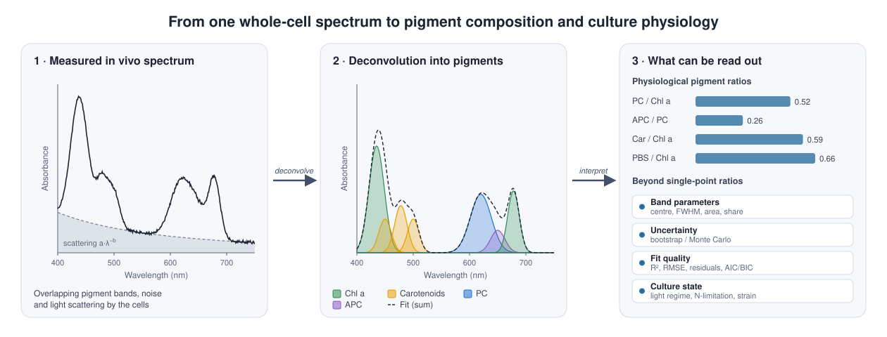

# Cyanobacteria Absorption Spectra: Analysis & Deconvolution

An open-source Python library for analyzing and deconvoluting *in vivo* absorption spectra of cyanobacteria. 



*Figure 1. The idea behind the project. A measured whole-cell spectrum (1) is the sum of overlapping pigment bands, noise and light scattering. Deconvolution separates it into the contributions of individual pigments (2), from which quantitative, physiologically meaningful parameters can be derived (3). The spectra shown are synthetic and serve only as an illustration.*

## Contents

- [Background](#background)
- [The problem](#the-problem)
- [What this library does](#what-this-library-does)
- [Methods](#methods)
- [Validation against synthetic ground truth](#validation-against-synthetic-ground-truth)
- [Installation](#installation)
- [Input data](#input-data)
- [Usage](#usage)
- [Design principles](#design-principles)
- [Roadmap](#roadmap)
- [Context and acknowledgements](#context-and-acknowledgements)
- [License](#license)

## Background

Cyanobacteria are photosynthetic prokaryotes. To capture light, they rely on several classes of pigments, each absorbing in a characteristic part of the visible spectrum:

| Pigment | Role | Main in vivo absorption bands |
|---|---|---|
| **Chlorophyll *a*** (Chl *a*) | Core photosynthetic pigment in both photosystems | ~435 nm (Soret band), ~678 nm (Q<sub>y</sub> band) |
| **Carotenoids** (Car) | Accessory light harvesting and photoprotection | ~450, ~478 and ~500 nm |
| **Phycocyanin** (PC) | Phycobiliprotein of the phycobilisome antenna | ~620 nm |
| **Allophycocyanin** (APC) | Phycobilisome core; transfers energy to the photosystems | ~650 nm |
| **Phycoerythrin** (PE) | Phycobiliprotein present only in some strains | ~565 nm |

The phycobiliproteins (PC, APC, PE) are assembled into large antenna complexes called **phycobilisomes** (PBS). Cyanobacteria continuously adjust the amount and ratio of these pigments in response to light intensity, light quality and nutrient availability, a process known as **acclimation**. The pigment composition of a culture is therefore a direct readout of its physiological state.

The simplest way to see this composition is to measure the **absorption spectrum** of a cell suspension in a spectrophotometer: the absorbance of the culture is recorded as a function of wavelength, typically between 400 and 750 nm. The measurement takes about a minute, needs no extraction and does not destroy the sample.

## The problem

A whole-cell spectrum contains far more information than is routinely extracted from it, for two reasons.

**Band overlap.** The absorption bands of individual pigments are broad and overlap strongly. The chlorophyll Soret band coincides with the carotenoid bands, and the PC, APC and Chl *a* Q<sub>y</sub> bands merge into a single broad feature between 600 and 700 nm. What the spectrophotometer records is the *sum* of all contributions (Figure 1, panel 1).

**Light scattering.** Whole cells do not only absorb light but also scatter it. Scattered light does not reach the detector and is recorded as apparent absorbance. This adds a smooth, wavelength-dependent background that rises towards shorter wavelengths and distorts both the shape and the height of the pigment bands.

Because of these effects, common practice reduces the spectrum to a few single-wavelength ratios, such as A<sub>680</sub>/A<sub>620</sub> as a proxy for the chlorophyll-to-phycocyanin ratio. Such ratios are quick, but they are affected by overlapping bands and by scattering, and they use only a small fraction of the measured data.

The goal of this project is to recover the **individual pigment contributions** from the full spectrum, a process called **deconvolution** (Figure 1, panel 2), and to convert them into **interpretable physiological parameters** (Figure 1, panel 3), with quantified uncertainty and with a validated estimate of how reliable the result is.

## What this library does

The library implements the complete analysis chain as a set of independent, testable steps:

```
raw data ─► parsing ─► quality control ─► preprocessing ─► deconvolution ─► derived parameters ─► visualisation / classification
```

1. **Parsing** reads spectra from files or from text pasted out of a spreadsheet and resamples them onto a common 1 nm wavelength grid.
2. **Quality control** checks the data for common measurement problems and reports them as structured findings.
3. **Preprocessing** applies optional, fully logged corrections: scattering removal, smoothing, normalisation and averaging of replicates.
4. **Deconvolution** separates the spectrum into pigment contributions using two independent methods.
5. **Derived parameters** converts the fitted bands into band areas, positions, widths and physiological ratios.
6. **Visualisation** produces publication-ready figures of spectra, derivatives and fit results.
7. **Classification** uses spectra or derived features to predict the state of a culture (e.g. light regime, nitrogen limitation, strain).

## Methods

### Scattering correction

Scattering is approximated by a power law in wavelength,

$$
A_{\text{scat}}(\lambda) = a \cdot \lambda^{-b},
$$

whose parameters $a$ and $b$ are fitted in the near-infrared region, where pigments absorb negligibly, and then subtracted from the whole spectrum. A simpler alternative, subtraction of the absorbance at 750 or 800 nm, is also available.

### Deconvolution

Two methods are implemented behind a common interface, so that they can be compared on identical data.

**Gaussian decomposition.** The spectrum is modelled as a sum of Gaussian bands,

$$
A(\lambda) = \sum_{i} h_i \exp\!\left(-\frac{(\lambda - c_i)^2}{2\sigma_i^2}\right),
\qquad \text{FWHM}_i = 2\sqrt{2\ln 2}\,\sigma_i ,
$$

where $h_i$ is the height, $c_i$ the centre and $\sigma_i$ the width of band $i$. Bands are initialised at the known in vivo positions listed in the table above and fitted by bounded least squares. The centre of each band may move by at most ±5 nm and its width is constrained to a physically plausible range. These constraints prevent the fit from producing mathematically good but biologically meaningless solutions.

**Unmixing onto a reference library.** The spectrum is expressed as a non-negative linear combination of measured reference spectra $S_j(\lambda)$ of the individual pigments,

$$
A(\lambda) \approx \sum_j w_j\, S_j(\lambda), \qquad w_j \ge 0,
$$

and the weights $w_j$ are found by non-negative least squares (NNLS). The weights correspond directly to relative pigment contents. The reference library is a versioned set of CSV/JSON files in which every spectrum documents its origin (in vivo or in vitro, solvent, method, literature source); users can add their own spectra without changing the code.

### Fit quality and uncertainty

Each fit is reported together with R², RMSE and the residual spectrum. The number of bands is selected using the Akaike and Bayesian information criteria (AIC/BIC), which penalise unnecessary model complexity. Parameter uncertainties are estimated by bootstrap resampling of residuals or by Monte Carlo perturbation of the noise.

### Derived parameters

For every band the library reports area, amplitude, centre, FWHM and relative share of the total. These are combined into physiological ratios commonly used in cyanobacterial research:

| Ratio | Interpretation |
|---|---|
| PC / Chl *a* | Size of the phycobilisome antenna relative to the photosystems |
| APC / PC | Phycobilisome core relative to its rods; reflects antenna architecture |
| Car / Chl *a* | Photoprotective capacity; typically increases under high light and stress |
| PBS / Chl *a* | Total phycobiliprotein antenna relative to chlorophyll |

### Classification of culture state

On top of the analysis layer, the library includes models that classify the state of a culture from its spectrum. Two strategies are compared:

- models trained directly on the **raw spectrum** (PLS-DA, one-dimensional convolutional neural network), and
- models trained on **mechanistic features** obtained by deconvolution (band parameters and pigment ratios).

All models are evaluated with honest cross-validation, and overfitting is discussed explicitly. A rule-based interpreter that requires no trained model is provided as a transparent baseline.

## Validation against synthetic ground truth

A fitted curve that *looks* good does not prove that the recovered pigment composition is correct. Several different combinations of overlapping bands can reproduce the same measured spectrum almost equally well.

To obtain an objective criterion of correctness, the project starts with a **synthetic spectra generator**. Given a defined pigment mixture, it produces a realistic spectrum including noise and a power-law scattering term. Because the mixture is chosen in advance, the true band areas, centres and pigment ratios are known exactly.

Both deconvolution methods are then run on the same synthetic data, and the estimation error is measured as a function of:

- the noise level,
- the degree of band overlap,
- the error in the scattering correction.

A method is considered correct when the recovered composition matches the known composition within a stated tolerance. This tolerance is written as a `pytest` assertion, so correctness is verified automatically on every test run rather than judged visually once. The benchmark determines the default deconvolution method and documents the conditions under which each method fails.

The same ground truth also addresses the central scientific question of the project: **does explicit, mechanistic feature extraction improve classification, or can a neural network learn the same information directly from the raw spectrum?**

## Installation

TBD

## Input data

Spectra are provided as a table in which the first column contains wavelengths (nm) and each further column contains the absorbance of one sample:

```
wavelength	WT_LL_rep1	WT_LL_rep2	WT_HL_rep1
400	0.512	0.508	0.634
401	0.515	0.511	0.639
...
```

Supported sources are Excel files, delimited text files (the delimiter and the use of decimal comma or decimal point are detected automatically) and text copied directly from a spreadsheet. All spectra are interpolated onto a common 1 nm grid and a shared wavelength range.

An optional **metadata table** can describe each sample (strain, light regime, time point, replicate). Metadata is required for comparisons between groups and for classification.

The data handled by this library consist of optical density measurements of cyanobacterial cultures and descriptive metadata. They contain no personal or confidential information, which allows example datasets and the reference spectral library to be distributed openly as part of the repository.

## Usage

> **Note:** the interface below reflects the planned design and may change during development.

```python
from cyanospectra import parse_table, analyze

spectra = parse_table("data/example_spectra.xlsx")

result = analyze({
    "spectra": spectra,
    "preprocessing": {"scattering": "power_law", "smoothing": "savgol"},
    "deconvolution": {"method": "gaussian"},
})

result["ratios"]      # e.g. {"PC/Chl": 0.52, "APC/PC": 0.26, ...}
result["qc"]          # list of structured quality-control findings
```

Text pasted from Excel can be parsed directly:

```python
from cyanospectra import parse_pasted
spectra = parse_pasted(clipboard_text)
```

## Design principles

The library is written so that it can be used by third parties without any knowledge of the project, and so that it can later be integrated into a web platform without being rewritten.

- **Pure functions.** Analysis functions take data in and return results; they perform no file input/output and keep no global state.
- **Serializable outputs.** All results are plain, JSON-serializable dictionaries. Spreadsheet exports are returned as bytes rather than written to disk.
- **Separation of layers.** Parsing, analysis and visualisation are strictly separated.
- **Structured diagnostics.** Quality-control problems are returned as findings with a code, severity and message, never as printed warnings.
- **Reproducibility.** Every preprocessing step is logged with its parameters, so any analysis can be replayed exactly. Random processes are seeded.
- **Figures without side effects.** Plotting functions return a Matplotlib `Figure` and never call `show()` or `savefig()`.
- **Lightweight deployment.** Neural network models are shipped as pre-trained weights with NumPy or ONNX inference, so no deep-learning framework is needed at runtime.
- **Single entry point.** `analyze(payload: dict) -> dict` wraps the complete pipeline.

## Roadmap

Development follows a fixed order, because no later step can be evaluated without the synthetic generator. Each step is delivered with its own tests.

- [ ] **Synthetic spectra generator**: seeded generation of spectra with known composition, noise and scattering; verified by round-trip fitting
- [ ] **Data parsing**: files and pasted text, delimiter and decimal detection, resampling, metadata
- [ ] **Quality control**: saturation (A > 1.5), negative values, narrow range, noise level, outlier replicates
- [ ] **Preprocessing**: scattering correction, Savitzky–Golay smoothing, normalisation, replicate averaging
- [ ] **Reference spectral library**: versioned, documented pigment spectra
- [ ] **Deconvolution**: Gaussian decomposition and NNLS unmixing behind one interface
- [ ] **Benchmark**: systematic comparison against ground truth; choice of default method
- [ ] **Derived parameters**: band parameters and physiological ratios
- [ ] **Visualisation**: overlays, difference spectra, 2nd/4th derivatives, deconvolution with residuals
- [ ] **Classification**: raw-spectrum vs. mechanistic-feature models, rule-based interpreter
- [ ] **Handover packaging**: serializable outputs, session files, single `analyze()` entry point

## Context and acknowledgements

This library is being developed as a future module of the [cyano.tools](https://cyano.tools) platform of the Department of Adaptive Biotechnologies, Global Change Research Institute of the Czech Academy of Sciences (CzechGlobe). The web layer is outside the scope of this repository.

### Selected references

- Savitzky, A., & Golay, M. J. E. (1964). Smoothing and differentiation of data by simplified least squares procedures. *Analytical Chemistry*, 36(8), 1627–1639.
- Lawson, C. L., & Hanson, R. J. (1974). *Solving Least Squares Problems*. Prentice-Hall.
- Zavřel, T., Sinetova, M. A., & Červený, J. (2015). Measurement of chlorophyll *a* and carotenoids concentration in cyanobacteria. *Bio-protocol*, 5(9), e1467.

## License

Released under the [MIT License](LICENSE).
